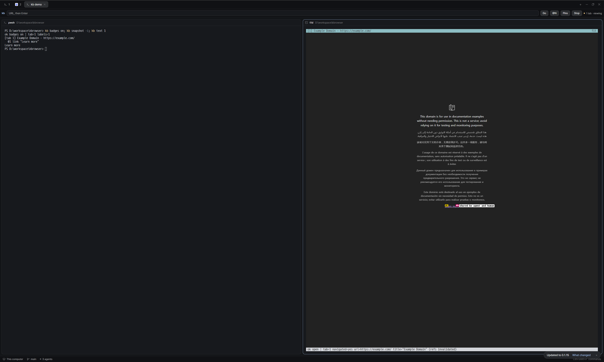

# kb browser, a Herdr layout

[Herdr](https://herdr.dev)'s main window with a browser address bar under the
tabs. Type a URL and press Enter: the page opens in a live browser pane beside
your agent's terminal. The agent drives the same browser with `kb` commands, so
you watch what it clicks and it reads the notes you pin on the page.



## Add it

1. Install [`kb`](https://github.com/stardino2lab/kbrowser), the terminal
   browser this layout runs. It needs Rust and Chrome, Chromium or Edge:

   ```
   cargo install --git https://github.com/stardino2lab/kbrowser
   ```

2. In Herdr, ask your agent:

   > Add the layout from https://github.com/stardino2lab/herdr-kb-browser

   Or by hand: copy `layouts/kb-browser.json` into `~/.config/herdr-app/layouts/`
   and `mods/kb-browser/` into `~/.config/herdr-app/mods/`, then switch layouts
   with `Ctrl+Shift+L`.

Your own layout stays as it is; deleting those two things removes this one.

## What it runs

The bar runs the `kb` program and nothing else. It reaches no network itself
and reads no files. `kb` starts a background daemon and a headless Chrome on
first use; the **Stop** button ends both.

[RECIPE.md](RECIPE.md) is the full brief: what you see, how it behaves, what
it is built from and how to check a build.

## License

MIT
